# Team Fund Bot

> Generated from `docs/architecture.html` by `scripts/build-docs.py`. Open the HTML file for the interactive version with dark mode.

_System design · v6 · clean architecture_

Every team gets its own Telegram bot for collecting the monthly fee. A master bot registers new teams. Members open their team's bot, tap whose fee they are paying, scan a SePay QR, and the payment confirms itself. One Python server runs the master bot, every team bot and the webhooks. It follows Clean Architecture: business rules in the middle, Telegram, HTTP and the database at the edges, and every dependency pointing inward.

## System overview


Legend: Telegram traffic and calls inside the app · Money path: transfer to confirmation

_The master bot's token is set once in `.env`. Team bot tokens come from owners through `/newteam` and are stored encrypted. The amber arrows are the money path: a SePay webhook enters through `interfaces/http`, which turns SePay's JSON into an `IncomingTransfer`; a use case checks the team's key, matches the transfer to bills with the domain rules and saves it through the repository ports; the resulting event goes out through the notifier port to `interfaces/bot` for the receipt and the followers' announcement. The public address is `teamfund.103-90-225-28.sslip.io`; the existing nginx keeps port 80, so Caddy gets its certificate on 443._

## Clean Architecture

The code is arranged in rings. Code in a ring may only use code in the rings inside it, so the business rules never depend on Telegram, FastAPI or the database, and any of those can be replaced without touching them. `tests/test_architecture.py` fails if a file imports outward.


_Control flows outward and back (a webhook calls a use case, the use case saves through a repository), but every source-code dependency points inward. Use cases ask for what they need through ports, small interfaces in `application/ports.py`, and the outer ring provides the implementations. `main.py` is the composition root: the only file that knows every concrete class and wires them together._

| Ring | Folder | What's in it | May import |
|---|---|---|---|
| Domain | `domain/` | `entities.py`: Team, Member, Bill, Payment, PaymentIntent and the rest, as plain dataclasses. `rules.py`: fees, cost splitting, payment codes, reminder days, validation. `errors.py`. | nothing |
| Use cases | `application/` | One class per area: registration, users, teams, members, money, jobs. `access.py` (owner and manager checks), `billing.py` (bills, intents, matching transfers), `ports.py` (repositories, unit of work, clock, cipher, QR, spreadsheet, notifier), `services.py`. | domain |
| Adapters out | `infrastructure/` | `orm.py` maps the domain dataclasses onto tables, so the domain never imports SQLAlchemy. `repositories.py`, `db.py` (unit of work), `clock.py`, `crypto.py` (Fernet), `sepay.py` (QR URL, and the SePay user API that creates each team's webhook), `xlsx.py`. | application, domain |
| Adapters in | `interfaces/` | `bot/`: aiogram handlers, texts and message builders. `http/`: Telegram webhooks and the SePay webhook, which turns SePay's JSON into an `IncomingTransfer`. `scheduler.py`. `deps.py` gives controllers the use cases. | application, domain |
| Composition root | `main.py` | Builds the adapters, passes them to the use cases as `Deps`, starts FastAPI, the bots and the scheduler. | everything |

### Tests by ring

- **Domain rules:** pure functions, no database (`test_rules.py`).
- **Use cases:** the real SQLAlchemy adapters on SQLite, with a fixed clock and a recording notifier, so reminders and month-end are tested on chosen dates (`test_use_cases.py`).
- **Dependency rule:** `test_architecture.py` reads every import.
- **Whole server:** `tests/e2e.py` drives the bots against a fake Telegram API.

## Setting up

### Once, by you: the master bot

1. **Create it in @BotFather** with `/newbot`, e.g. `@TeamFundSetupBot`. Turn off `/setjoingroups` so it only works in private chats.
2. **Put the token in `.env`** as `MASTER_BOT_TOKEN`, with your Telegram ID in `MASTER_ADMIN_IDS`.
3. **Start the server.** The app sets the master bot's webhook to `/tg/master`.
4. **Optional: let the master bot create team bots.** Put your Telegram app's `TELEGRAM_API_ID` and `TELEGRAM_API_HASH` (my.telegram.org) in `.env`, then log in once: `docker compose exec app python -m app.telegram_login phone +84…`, then `… code <code from Telegram>` (and `… password` if the account has 2FA). `… status` shows who is logged in; `… logout` revokes it.

### Per team, by its owner

1. **Ask the master bot.** Send `/requestteam` with the team name. The system admin gets Approve / Reject buttons, and the requester is told the result.
2. **Get the team bot.** With the login above, the approval message has **🤖 Create the bot for me** (also offered by `/newteam`): the server chats with @BotFather from the admin's account (`/newbot`, the name "<team> · Team Fund", then usernames like `fc_37_it_fund_bot`, `…_tf_bot`, `…_fund2_bot` until one is free) and reads the token. Without it, the owner creates the bot in @BotFather with `/newbot`, sends `/newteam` and pastes the token. Bots made for you belong to the admin's Telegram account, which can hold 20. A system admin needs no request: `/newteam`, then type the team name. Until the login is set up, `/newteam` tells the admin how.
3. **Registration** is the same either way: the server checks the token, creates the team, sets the webhook to `/tg/{botId}`, and makes the requester the owner.
4. **Link the bank account in SePay** (my.sepay.vn → Ngân hàng → Thêm tài khoản, with the bank's OTP), and for VA-only banks such as BIDV personal create a VA there. Then create an API token (Cấu hình công ty → API Access).
5. **Connect SePay and pick the account.** In the team bot, send `/sepaytoken <token>`. The bot lists the accounts linked in that SePay (one button per VA for VA-only banks); one tap saves the team's account and creates its webhook. Only the owner can do this, and the account can't be typed in: only an account SePay watches can confirm payments. To change it later, `/setbank` shows the same list. Anyone can check it with `/bank`.
6. **Share the bot's link with members.** Everyone who taps Start follows the team: they get its announcements privately (no group needed). `/notify` turns them off.
7. **Add members and the fee:** `/members` → ➕ Add members, `/plans` → 💰 Default fee (and ➕ New plan for other amounts or cycles), then 📅 Deadline and ⏰ Late fee for each package.

## Payment flow

No one signs in. Whoever opens the team bot sees this month's unpaid list and taps the names they are paying for, usually just their own.


_The unique code in the transfer memo is what lets the server match money to bills with no human check. Bills being paid are locked in the database until the payment is saved (`SELECT … FOR UPDATE`), so a transfer and a `/markpaid` at the same moment, two managers recording the same cash, or two managers charging one match fee can't pay or bill anything twice. Each intent expires after 24 hours. If the amount doesn't match or the code is missing, the transaction is still saved and a manager is asked to assign it. A transfer whose code matches an expired QR is saved but not matched on its own: the payer hears that a manager will confirm it, and managers get a card naming who the QR was for, with a one-tap ✅ Mark paid: … for them (or assign to pick others). SePay's transaction id is stored, so a repeated webhook can't count the same payment twice. For VietinBank accounts the memo is `SEVQR TF…`: SePay's VietinBank link only reports transfers whose content starts with `SEVQR`, and the server finds the TF code anywhere in the text._

## Webhooks in detail

Telegram and SePay both push events to the server over HTTPS; nothing polls. Each sender proves who it is with a secret only it and the server know, and the server answers quickly so the sender doesn't retry.

### Telegram → team bot


_Each bot has its own webhook URL and secret token, set when the server starts and stored per team. Telegram sends that token in the `X-Telegram-Bot-Api-Secret-Token` header, so a request without it is refused before any bot code runs. The handler runs the use case in a worker thread, so a slow database call never blocks other updates. Replies go out as separate outbound calls to `api.telegram.org`; the 200 only tells Telegram the update was received. Telegram resends an update until it gets a 2xx, so the server answers 200 even when a handler fails (the user sees the error message instead)._

### SePay → payment confirmed


_SePay watches the team's bank account and calls the webhook within seconds of money arriving. Only the use case decides what the transfer means: the key is compared by its hash, a transaction already recorded is skipped (so SePay's retries are harmless), and money with no code or too little is kept and sent to the managers to assign. The server answers `{"success": true}` as soon as the payment is saved; the receipt and the followers' announcement go out in the background through the notifier port, so a slow Telegram call can't make SePay time out and resend._

### /setbank → the team's account and webhook, in one tap


_The owner does only what SePay can't let anyone else do: link the bank account (with the bank's OTP), create a VA for VA-only banks, and create one API token. One tap in `/setbank` does the rest, and the chat shows every action as it happens (reading SePay, the account found, the VA, a new key, "creating / overwriting webhook …", saving, telling the followers); the same steps go to the server log and `/log`. If a step fails, the message names it and the reason, and nothing is saved, so the old key keeps working. Tapping the current account again repairs a webhook that was edited or deleted in SePay. There is always one webhook per team: the stored id is reused, a webhook already pointing at the team's URL is adopted, and one deleted in SePay is recreated. SePay's v2 user API isn't in its public docs yet; `infrastructure/sepay.py` follows what it answers today (updates are `PUT`, writes need an `X-Idempotency-Key`)._

## Pay page for members without Telegram

Some members won't install Telegram. Each team has a **pay page**, a small web app (PWA) at a secret link, with three tabs. **Đóng quỹ** (Pay) does what `/start` does in the bot: list who still owes, tick names, get the VietQR, and see it confirmed. The other two are read-only: **Quỹ** (Fund, like `/fund` and `/history 10/2026`: money in, money out and balance, then one collapsible block per month from the team's first record to now, each with that month's in, out and net; opening a month lists every transaction in it, newest first, and the current month starts open) and **Thành viên** (Members: everyone's total debt, biggest first, broken down into the bills behind it, plus shirt number, fee and cycle, and status). It reads and writes the same database through the same use cases, so a payment on the page shows up in the bot, `/status`, the reports and the announcements, and the other way round. Managing stays in Telegram: the page can't add members, change fees or record expenses.


_The page is one HTML shell with plain JavaScript (no build step) in `interfaces/web/`, served by `interfaces/http/web.py`; `application/web.py` holds the only three things it may do. A payer on the page has no Telegram account, so there is no private receipt: the page itself shows ✅, and the followers still get the "paid" announcement. Everything else, from matching the TF code to expiry after 24 hours, is the same code path as the bot._

| Concern | How it's handled |
|---|---|
| Getting the link | A manager sends `/weblink` in the team bot and shares the link (Zalo, Messenger, a printed QR). **🔄 Make a new link** replaces it; the old one stops working at once. |
| Who can open it | Anyone with the link, with no login, like the bot's `/start`. The token is 16 random characters, so team pages can't be guessed or listed. |
| What it shows | Team name and bank account; unpaid members with their bills; the fund (in, out, balance) and its months back to the first record (at most 36), each month's transactions fetched when it's opened (`GET api/month/YYYY-MM`); the roster with each person's debt. **Never** phone numbers or member notes (the bot shows those to managers only), and never the raw bank memo of a transfer, which can carry the sender's full name and bank references: payments are labelled by whom they paid for, and an unassigned transfer only as "not assigned yet". |
| What it can do | Read the page and one month's transactions, create a QR for chosen members, and poll that QR's status. Nothing else. |
| Abuse | Per-IP limits: 10 QR codes and 120 reads a minute. Unpaid QR codes simply expire. |
| Keeping the link private | `Referrer-Policy: no-referrer` (the QR image comes from qr.sepay.vn and must not see the link), `noindex`, and a strict Content-Security-Policy: only our own scripts run, and names are inserted as text, never HTML. |
| Guide | A ❓ Guide button in the header opens a four-step how-to (pay, scan, the other tabs, add to home screen) plus a link to the team bot. It opens by itself on a device's first visit; closing it is remembered on that device. The same how-to is the `/guide` command in the bot. |
| Installing | A web app manifest and a service worker scoped to that team's path: "Add to home screen" on Android and iPhone. The app shell works offline; amounts always come live from the server. |
| Language | The team's language by default, with a Tiếng Việt / English switch remembered on the device. |

## Banks and SePay

SePay only confirms money it can see, and what it can see depends on the bank and on the account type chosen when the account was linked. Two things vary: whether a transfer to the **main account number** is reported at all, and whether the transfer content needs a keyword. Check this table before setting up a team on a new bank. Source: developer.sepay.vn › Ngân hàng hỗ trợ, read 17/11/2026; SePay changes it, so re-check there.

### What a VA is

- **VA (virtual account, tài khoản ảo)**: an extra account number that belongs to the same real bank account. Money sent to it lands in the main account, but the bank tells SePay which VA it came through (the webhook's `subAccount` field). Created in my.sepay.vn → **Tài khoản ngân hàng** → the account → **Tài khoản ảo**.
- **VA chính thức** (official VA): the bank issues it; it has its own number, and payers transfer to that number.
- **VA nội dung (TKP)**: no own number; payers transfer to the main account with a `TKP…` code in the content. For banks that don't issue official VAs.
- **"Không, chỉ qua VA"** in the table below means a transfer straight to the main account number is **never reported**: the team needs at least one official VA, and the QR must carry the VA number instead of the account number. Accounts linked by **SMS banking** are the exception: they report main-account transfers at every bank.

### Supported banks (API link)

| Bank | Account type | Main account reported | Official VA | What Team Fund's QR needs |
|---|---|---|---|---|
| VietinBank | Cá nhân, hộ kinh doanh | Yes | No | Content must contain `SEVQR` (done: `SEVQR TF…`) |
| VietinBank | Doanh nghiệp with Thu hộ định danh MAP | **No, VA only** | Yes | VA number |
| VietinBank | Doanh nghiệp without MAP | Yes | Yes | Main account |
| BIDV | Cá nhân, hộ kinh doanh | **No, VA only** | Yes | VA number |
| BIDV | Doanh nghiệp | Yes | Yes | Main account |
| Vietcombank | Doanh nghiệp, hộ kinh doanh | **No, VA only** | Yes | VA number |
| MSB | All | **No, VA only** | Yes | VA number |
| OCB | All | **No, VA only** | Yes | VA number |
| KienlongBank | All | **No, VA only** | Yes | VA number |
| VPBank | Cá nhân, hộ kinh doanh (NEO / NEOBiz) | Depends on the link: only if **Đồng bộ tài khoản chính** was chosen | Yes | VA number, unless the main account is synced |
| VPBank | Doanh nghiệp (NEOBiz) | Yes | No | Main account |
| ACB | All | Yes | Yes | Main account |
| MBBank | All | Yes | Yes | Main account |
| Sacombank | Cá nhân, hộ kinh doanh | Yes | Yes | Main account |
| TPBank | All | Yes | No | Main account |
| Shinhan Bank | Doanh nghiệp | Yes | Yes | Main account |

A bank missing from the table doesn't send webhooks. For an account already linked, SePay's bank-account API answers directly and overrules the table: `va_only: true` means VA only. Team Fund handles both cases. The `SEVQR` keyword comes from `domain/rules.py` `transfer_content`. For VA-only accounts, the `/setbank` picker reads `va_only` and lists the account's active official VAs from SePay (`GET /v2/bank-accounts/{xid}/va`) as the choices; the chosen VA is stored as the team's `pay_account`, and the QR, its caption, `/bank` and the pay page show it. Money sent there lands in the same account. An account with no VA yet is listed with "needs a VA" and tapping it explains how to create one in my.sepay.vn.

## Fees, plans and income

Every member pays one fee: their **fee plan** if they're on one, else their own monthly fee (set on the member screen), else the team's default fee (`/plans` → 💰 Default fee). A plan is an amount plus a cycle (month, quarter, 6 months, year), so "An, Bình, Cường pay 150k a month, Dũng, Em, Phúc pay 300k a quarter" is two plans. Money that isn't anyone's fee (a prize, a sponsor, the balance from before the bot) goes in with `/income`.



_One bill per cycle: a quarterly bill covers its three months, so Cường counts as paid in November and December without a new bill. Income and expenses are no one's bill: they only move the fund balance, in the month of the date they carry._

| Command (managers) | What it does |
|---|---|
| `/plans` | Lists the default fee and each plan with its members. Buttons: 💰 default fee and 🔁 its cycle (month, quarter, 6 months or year, `Team.fee_months`; everyone not on a plan pays it; a member's own fee stays monthly; replaces the old `/setfee`), ➕ new plan (cycle → amount → pick members), and per plan 👥 members, 📅 months it applies, 💰 amount, 🔁 cycle, 🗑 delete. |
| `/plans 300k quý` | Quick create: goes straight to picking members. Cycle words: tháng / quý / 6 tháng / năm, or month / quarter / 6 months / year. |
| `/income 2tr Thưởng vô địch` | Records income (there is one kind: prizes, sponsors, opponents paying, the old balance all read the same; only member fees are shown by name). Announced to followers; counts in `/fund`, `/history`, the month totals and the pay page. |
| `/income 1.5tr Số dư đầu kỳ 31/10``/expense 300k Sân bóng 15-10-2026` | A date at the end (`dd/mm/yyyy`, `dd-mm-yyyy`, `dd/mm/yy`, `dd-mm-yy`, `dd/mm` / `dd-mm` for this year, or `mm/yyyy` / `mm-yyyy` for the 1st of that month) records it on that day (noon, team time); without one it's now. Being stored at that time, it sorts into place in the transaction log and falls under its own month in `/history 10/2026`, the month totals and the pay page's month blocks. Not in the future, at most 3 years back. Amounts can be `450k`, `1tr`, `1.5M`, `1tr5`, `5M`, `450.000`…; `/money` lists every form. A bare `/income` or `/expense` explains the format and takes the answer as a reply. |

- A member is on at most one plan. Picking them for a plan moves them off any other; a plan nobody is left on is deleted.
- Bills follow standard periods: quarters Jan–Mar, Apr–Jun, Jul–Sep, Oct–Dec; half-years Jan–Jun and Jul–Dec; years Jan–Dec. A bill opens at the start of its period and is due on that month's announcement day plus the deadline (Oct–Dec: e.g. 05/10). A member whose earlier months in the period are already paid (say, October as a monthly member) is billed only for the rest, priced pro rata (600k a quarter from November: 400k); a new member put on a plan is billed the whole period by default. What a manager can change: see Months a package applies below.
- A month counts as paid for a member when the fee bill that covers it is paid, so a quarter paid in November shows them as paid in December and January.
- Changing a plan, the team fee or a member's own fee reprices only unpaid fee bills opened this month. A quarter that's already running keeps its amount; the new fee starts when it runs out. Waive it on the member's bills screen if it should stop sooner.
- Cash that differs from the bill: pick one person in `/markpaid`, then ✏️ Another amount. The money goes to their oldest bills first, and the fund grows by that amount only. For the rest, ✔️ **let it go** settles that bill at what was paid (someone who joined mid-quarter pays 300k of 600k), or ⏳ **still owes** keeps the rest as a new unpaid bill. More than owed: every bill is paid and the extra stays in the fund, as part of the same cash payment (one `/undo` takes it all back). A SePay transfer below the amount goes to `/unmatched`, where assigning it closes the bills with the amount that actually arrived.
- Two teams on one bank account: each team's webhook hears every transfer on it. Only a transfer carrying this team's QR code counts for it; anything else (the other team's code, or no code at all) is ignored, with no warning. A team on its own account still gets ⚠️ for transfers without a code. Separate VAs per team would split them at the webhook instead.
- Setting a member's own monthly fee takes them off their plan. Deleting a plan moves its members back to the default.
- **Several packages, one at a time.** A member can be on several plans (`plan_members`: plan, member, start, until), e.g. 600k for 2026Q4 then 200k from 2027Q1, but never two in the same month. Picking someone for a plan whose periods would overlap another of theirs leaves them out with a warning that names the clashing plan and its periods, then asks for other periods; choosing overlapping periods is refused the same way. Months no plan covers are paid on the default package. Unticking someone in a plan's 👥 Members takes them off that plan only; a plan nobody is on is deleted. (Members used to hold one plan in `members.plan_id`; the server moved those into `plan_members` once, at startup.)
- **Periods a package applies.** Each membership covers whole periods of the plan's cycle, stored as months: `start` (a period's first month) to `until` (a period's last month), both inclusive. By default it's from the current period, for good. Members who join a plan are asked right away, and 📅 Months it applies changes it later for any of the plan's members:  **From next period** (the usual choice for a newcomer): nothing on this package until the next period starts. Until then they're on the default package. **From this period** (applied until changed): bills the whole period, due and fined like everyone else. **This period only** (a guest or a short stay): this period's bill, then back to the default package. **📆 Pick a range**, with buttons in the plan's own cycle: a quarterly plan offers quarters (2026Q4, 2027Q1 … the next 8), a monthly plan months (12), half-years (6), years (4). Pick the first period, then the last (included) or ♾ For good. Typing works too, and the message shows how with examples in the plan's cycle: `2027Q1 - 2027Q2`, `2027Q1` (from then on), `- 2027Q2` (from this period), or after tapping a start just the last period (`2027Q2`). Half-years are `2027H1`/`H2`, years `2027`, months `01/2027`. A range always covers whole periods, and the use case refuses anything else. Afterwards the member is back on the default package, with nothing billed when the default is 0đ.  A change reprices the unpaid bill covering this month straight away. A fine that a later due date cleared comes back if the bill goes overdue again. It's logged as "Đặt thời gian áp dụng gói" and can be undone.
- **Each package has its own terms** (the default package and every plan), set in `/plans` with 📅 Deadline and ⏰ Late fee. A plan follows the default package's until it gets its own; `-` puts it back. Bills remember the plan they were billed under, so their due date and fine follow that package. Each package's new bills are announced on its own announcement day (packages sharing a day share one post).
- **Deadline:** `15 5` announces the fee on the 15th of each month and makes it due 5 days later (the 20th); the deadline may run into the next month (`/setdue 25 10` → the 5th). A bill's due date is the announcement day of its first month plus the deadline. Reminders: 3 days before the due date, on it, then every 3 days while someone owes, never before the announcement. Defaults for a new team (and any package without its own): announced on the 1st, due 5 days later, no late fee.
- **Late fee:** `1k` adds 1,000đ per day to each overdue fee bill, as its own line "Phạt trễ N ngày", updated once a day by a job at 00:05 (also once at startup, and right after a package's terms change). Days are always counted from the bill's real due date (a quarter's: its first month's announcement day plus the deadline, e.g. 05/10), including days before the late fee was turned on. It stops growing when the fee is paid, freezes for paused members, isn't charged on `/charge` costs, and goes away when the fee is waived or when the package's late fee is set to `0`. A QR made one day and paid the next is accepted at the QR's amount.
- Reminders and the monthly "fee is open" post run when anyone has a fee: the team fee or a plan. The post lists each fee with how many people pay it.
- Plan changes, income and backdated records all go into `/log` (`plan.save`, `plan.delete`, `income.add`, with the date).

## Announcements and undo

### Followers instead of a group

Team bots don't work in groups. Everyone who opens a team bot privately **follows** the team (a new follower is welcomed once). Whatever used to be posted in a team group now goes to each follower privately: the fee is open, reminders, who paid (except to the payer, who gets the receipt), expenses, income, charges, a bank change, and undos of those. The person who caused an announcement doesn't get it again. `/notify` turns announcements off or on for yourself; someone who blocks the bot is muted. `/remind` sends the unpaid list to all followers and says how many got it. `/followers` (managers) lists who has opened the bot: name, @username, role, 🔕 if announcements are off, against the number of active members.

### Undo

`/undo` (managers) lists the recent actions you can take back, newest first, from the last 7 days. Pick any of them, not only the newest, confirm, and it's undone; **↩️ Undo another action** goes back to the list. Followers are told when an announced action is undone.

- Each undoable action's log entry keeps the rows it inserted, changed or deleted (the unit of work records them on every flush). Undo puts exactly those back.
- It only happens if every one of those rows is still as the action left it. A charge whose bill was paid since, a cash payment whose bills changed, or members who already have fee bills: the undo is refused with a reason and nothing changes. Fix those with a normal command.
- Undoable: expenses, income, cash payments (also part amounts), assigning or dismissing a transfer, charges and splits, waiving a bill, fee plans (save, delete, deadline, late fee), team settings, adding, editing or removing members.
- Not undoable, so never offered: anything about the bank, SePay, managers, the owner, the pay page link, and SePay payments themselves (the money really arrived). The undo itself is logged in `/log` (as `undo`) and can't be undone; undone actions show ↩️ there.
- A manager sees and undoes only their own actions; the owner can undo anyone's.

## Matches and contacts

Two tools for running the team. A match can carry money a manager records on it; `/expense` and `/income` still work for everything else. Use cases live in `application/matches.py` and `application/contacts.py`; the screens in `interfaces/bot/matches.py`, a router placed before the team router so its typed replies are seen first.

| Command | Who | What it does |
|---|---|---|
| `/matches` | everyone who opened the bot (managers edit) | The next 5 matches still on; cancelled ones stay listed between them, struck through with their reason, and don't count. Buttons show 10, 15 or all (`/matches 10` works too). For managers each match is its own button that opens its card (edit, cancel, ➖ Chi / ➕ Thu), plus ➕ Add match (day from buttons or typed → time and pitch, "as usual" from the calendar → opponent from contacts or typed), 🔁 Repeating and 🕘 Played (the last 5 played, also one button each, with 10, 15 or all). |
| `/matches` + lines | managers | Paste notes as written, one match per line: `7/12 19h FC Moreh @Sân A (áo trắng)`. Date first (any `/expense` form, optionally after a weekday like `CN`); then time (`19h`, `19h30`, `19:30`), opponent, `@pitch`, and anything in brackets as the note. A date alone is a day with no opponent yet. The bot shows what it read, and lines without a date as skipped, before saving. |
| `/matches cancel 30/11 mưa` | managers | Cancels the one match on that day; the rest of the line is the reason. |
| `/contacts` | everyone looks up and searches (to find and call an opponent); managers add, edit, delete. Also on the pay page's Danh bạ tab | Opposing teams A–Z, each with its phone in the list; a match whose opponent is a contact shows that phone on its card too; `/contacts moreh` searches name, phone and note, accents ignored. A contact is a name, a phone number (the usual way to reach a team, stored as 10 digits and shown as `0912 345 678`, which Telegram makes tappable) and a free note (fb, zalo, contact person, as written). Paste lines to add: `FC Moreh (0912 345 678, fb: Dũng)`. The name is what comes before the first bracket, dash or colon, the phone any Vietnamese number on the line (`+84` works), and the rest is the note. A team with the same name (accents, case and spaces ignored, so `KC United` = `KCUnited`) is updated, not duplicated; a match is linked to its contact by the same rule. A contact shows how many matches were played and cancelled against it, the last and the next, with three buttons: ✏️ Sửa tên, 📞 SĐT and 📝 Ghi chú. ➕ Thêm saves a team from its name alone and shows a short card with two optional buttons, 📞 Thêm SĐT and 📝 Thêm ghi chú, plus ✅ Xong; the bot only asks for what you tap. Several pasted lines are shown first, then saved. |

- **A match** (`matches`) is a day, and optionally a time, pitch, opponent and note. Status: scheduled, cancelled (with an optional reason), or deleted (hidden; a repeating calendar won't bring the day back).
- **Cancelling** from a match's card offers reasons (🌧 Mưa, 🙅 Đối huỷ, 👥 Thiếu người, 🎉 Nghỉ lễ, 🏟 Hết sân), a typed reason, or none. Followers are told at once. ↩️ Restore brings it back and tells them too. Cancelled matches get no reminder.
- **Repeating calendars** (`match_schedules`, at most 5): every week on a weekday, every 2 weeks from a first date, or every month (week 1–4 or the last week on a weekday, or a fixed day, clamped to short months). Each has a usual time and pitch. Their match days are filled 8 weeks ahead, without opponents, and never on a day that already has a match. Stopping one drops its future days that have no opponent or note; the others stay.
- **Money on a match.** Every match card has ➖ Chi and ➕ Thu for managers (tap the match in `/matches`, or in 🕘 Đã đá for played ones). Send an amount and an optional note (`300k tiền sân`, `200k trả đối`, `300k đối trả`): it becomes an expense or income titled "Trận 07/12 vs FC Moreh: tiền sân", dated on the match day (today for a match still ahead, like a deposit), added up on the match (`Match.paid`, `Match.received`, shown on its card and in the played list), and announced to followers like `/expense` and `/income`. One undo (match.money) takes back both the record and the match's total.
- **Match fee for occasional players.** 💵 Thu phí người đá on any match card (ahead or played): the manager types what each player pays for that match (the last amount is one tap), then ticks who plays. Each gets a bill titled "Trận 20/11 vs FC X" in the match's month (`Bill.match_id`), paid like any charge with `/start` or the pay page; nobody is charged twice for one match; followers are told. The card shows ✅/⏳ per player. Undo (match.fee) takes the bills back.
- **Reminders** (the `matches` job): from 18:00, followers get tomorrow's matches; from 09:00, managers are told about a match 7 days away with no opponent yet. Once a day each.
- **The pay page** has two more tabs: Lịch đá with the next 10 matches, and Danh bạ with every contact (name, phone as a tap-to-call link, note, played/cancelled, last and next match). The team chose to show phones there and in the bot: every member can look contacts up and ask opponents for a match. Each tab has its own link (`…/p/<token>/#contacts`, `#matches`) that opens the page on that tab; tab names wrap to two lines on narrow phones.
- Every change is logged and can be undone with `/undo` (match.add, match.update, match.delete, match.cancel, match.restore, schedule.add, schedule.stop, contact.save, contact.update, contact.delete).

## Scheduled jobs

The app runs its own scheduler: APScheduler inside the FastAPI process, started by `main.py` through `interfaces/scheduler.py`. It only says when; each job is a use case in `application/jobs.py` and runs in a worker thread, so the bots and webhooks never wait for it. A failure for one team is logged and the others carry on.



_All times are team time (`TEAM_TIMEZONE`, Asia/Ho_Chi_Minh). The jobs run inside the app process: there's no system crontab for them, so a deploy or restart carries them along._

| Job | When | What it does | Never twice because |
|---|---|---|---|
| `open_month` | every hour at :05, and once at start | Creates the fee bills each active member needs for this month (standard periods: a quarter's bill opens in Jan/Apr/Jul/Oct). On each package's announcement day, tells the followers its new bills, due date and late fee. | Bills: one per member per period (`monthly_key`). Posts: a `job_log` key per team, package and period. |
| `late_fees` | 00:05 every day, and once at start | Sets each overdue fee bill's "Phạt trễ N ngày" line to the days past its real due date × its package's rate. Paid bills stop; paused members freeze; a rate of 0 waives what's left. Also runs right after a package's deadline or late fee changes in `/plans`. | It recomputes from dates, so running it again the same day changes nothing. |
| `remind` | 09:00 every day | If any package is 3 days before its due date, on it, or a multiple of 3 days past it (and announced), sends followers one message listing everyone who still owes, with a pay button. | `job_log` key per team per day. |
| `matches` | every hour at :10, and once at start | Fills each repeating calendar's match days 8 weeks ahead. From 09:00, tells managers about a match in 7 days with no opponent; from 18:00, reminds followers of tomorrow's matches. | Days: one match per calendar date, none on a busy day. Messages: `job_log` keys per team per day. |
| `clean_up` | every hour at :30 | Expires QR codes older than 24 hours and manager requests older than 7 days. | Only changes what's still pending. |
| `ops_check` | 08:00 | Messages the system admins in the master bot only when something needs them: database down, disk ≥ 80%, newest backup older than 26 hours (or none), a bot's webhook failing or backed up, errors logged in 24 hours, money unmatched for over 3 days, a team with 3+ QR codes in 7 days and no SePay transfer at all, or a SePay plan at 80% or more of its transactions this cycle. `/ops` shows the same on demand. | Only reads; silent when all is well. |

- Nothing about fines changes on reads: opening the bot or the pay page shows what the last `late_fees` run set. A QR made one day and paid after the next run is accepted at the QR's amount.
- Only one app process runs the scheduler (one uvicorn worker). `RUN_JOBS=0` turns it off, which the tests use; they call the jobs directly with a fixed clock.
- Backups are the one thing scheduled outside the app: `scripts/backup.sh` from the host's crontab (see First deploy).

## Roles in a team bot

Each team bot keeps its own list of managers, keyed by Telegram user ID. That ID comes with every message and button tap and can't be faked, so the use cases check it before every manager action.

| Role | Who | Can do |
|---|---|---|
| Owner | Whoever registered the bot with `/newteam` | Everything a manager can, plus `/sepaytoken`, `/setbank` (pick from SePay; also sets up the webhook), approve or remove managers, `/transferowner`, `/log` |
| Manager | Approved by the owner | `/weblink` (makes the pay page link, 🔄 a new one), `/members` (view, ➕ add, edit, remove; the card lists every package with its periods, and 💳 Packages changes a package's periods, removes it, or adds a team package or a new typed one), `/plans` (default fee and plans), deadlines and late fees (in `/plans`), `/markpaid`, `/expense`, `/income`, `/charge` (each pays, or ➗ split), `/undo`, `/remind`, `/followers` (who opened the bot), assign unmatched payments, `/export` |
| Everyone | Anyone who opens the bot | `/start` and pay (or the pay page in a browser, no Telegram needed), `/donate` (💝 also on `/start` and the pay page: a QR for any multiple of 1.000đ, for guests and anyone who wants to chip in; whatever arrives with its code goes to the fund as “Ủng hộ: name”, the donor gets a thank-you and followers are told), `/status`, `/fund`, `/history` (or `/history 10/2026` for every transaction of one month), `/bank` (the team account; managers also see whether SePay is connected), `/notify`, `/lang`, `/requestmanager`, `/weblink` (see the pay page link once a manager has made it; no button to change it), `/guide` (a short how-to for the bot and the pay page, with the page link; managers forward it to the team chat) |

**Startup retries.** A team bot that can't reach Telegram when the app starts (a dropped connection during a deploy) is retried in the background after 5 s, 15 s, 1 min, 5 min, then every 10 min, and `/ops` lists it as “not running (retrying)” until it is up; `/health`'s `bots` count shows it too.

**💡 Tips.** A command sent bare (no arguments) gets one short line under its reply: the shortcut or next step people miss, e.g. `/fund` → “one month: `/history 11/2026`” (this month, tap to copy), `/donate` → `/donate 50k`, `/plans` → `/plans 300k quý`, `/markpaid` → `/undo`. Managers get their own version for `/matches` and `/contacts` (paste lines to add, cancel by date). No tip when the command came with arguments, on a refusal or an error, or on `/start` in a group; commands whose bare reply is already the how-to (`/help`, `/guide`, `/money`, `/expense`, `/income`, `/charge`, `/add`, `/sepaytoken`, `/teamlang`, `/undo`, `/followers`) have none. The texts are `tip.<command>` (`.manager` variant) and `mtip.<command>` for the master bot (`/myteams`, `/ops`) in both locales; `tips.py` arms the tip in the bot middleware and a request middleware on each bot's session adds it to the first message, photo or file sent back to that chat, so no handler knows about tips.

### Becoming a manager: request and approve



_The role check in step 7 runs on the server, so a forwarded Approve button does nothing for anyone but the owner. Requests that get no answer expire after 7 days._

- Only the owner approves or removes managers. Managers can't promote anyone.
- One pending request per person. After a rejection they wait 24 hours before asking again.
- `/requests` shows the owner every pending request, and `/managers` lists managers with Remove buttons.
- A change to the bank account is announced to every follower, so nobody can quietly redirect the fund.
- Every manager action goes into the audit log: who, what, when, and the old and new values.

## Deployment on the VPS

Everything runs on the one VPS with Docker Compose. Only port 443 is added to the internet. The services that were already on the server (nginx on 80, the app on 8000, the host Postgres, Tailscale) are left alone.



Legend: Telegram traffic · Money path · Other traffic, mounts, builds · Already on the server, not part of Team Fund

_Requests from Telegram, SePay and Let's Encrypt arrive on port 443 and Docker forwards them to Caddy. Caddy holds the certificate and passes `/tg/*`, `/sepay/*`, `/p/*` (the teams' pay pages) and `/health` to the app over the private Docker network; nothing else is public. A plain visit (GET) to `/` or `/sepay/*` gets a 200 text reply from Caddy itself, because SePay opens a URL to check that it exists before accepting it; the real webhook calls are POSTs and still need the team's API key. The app is the only code container: three containers in total. All state lives in three named volumes, so rebuilding or recreating containers loses nothing. Caddy runs with `--watch` and mounts the `caddy/` folder rather than the single file, so an edit to `caddy/Caddyfile`, by hand or through `scripts/deploy.sh`, takes effect within seconds without a restart. New teams need no Caddy change: `/tg/*` and `/sepay/*` already cover every bot and team._

## How a deploy works

The code goes to GitHub first, then the VPS pulls it and Compose rebuilds only what changed.



_Pushing to GitHub doesn't deploy anything by itself; running `scripts/deploy.sh` on the VPS does. If the health check fails, the script stops and prints the log command. Database rows and certificates survive every deploy because they live in volumes, not in the containers._

## Ports and exposure

| Port | Where | Reachable from | Used for |
|---|---|---|---|
| 443/tcp | host → caddy | Internet | Telegram webhooks, SePay webhooks, Let's Encrypt challenge, `/health` |
| 22/tcp | host sshd | Internet | Admin login. Git to GitHub goes outbound on 22. |
| 8000 | app container | Docker network only | Telegram and SePay webhooks, via Caddy. Not the host's own port 8000. |
| 5432 | db container | Docker network only | PostgreSQL for the app. Not the host's own Postgres. |
| 80/tcp | host nginx | Internet | Not used by Team Fund |

## Secrets and data

| Item | Lives in | Notes |
|---|---|---|
| MASTER_BOT_TOKEN | `.env` | From @BotFather. Anyone with it controls the master bot. |
| MASTER_ADMIN_IDS | `.env` | Telegram IDs that approve new teams |
| TOKEN_ENC_KEY | `.env` | Fernet key that encrypts team bot tokens in the database. Losing it means re-registering every team bot. |
| MASTER_WEBHOOK_SECRET | `.env` | Telegram sends it on every master bot update; team bots each get their own, stored in the database |
| POSTGRES_PASSWORD | `.env` | Only used inside the Docker network |
| Pay page links | database (`teams.public_token`) | One per team, from `/weblink`. Anyone with it can see who owes and pay; a manager replaces it with **🔄 Make a new link**. |
| SePay webhook keys | database (SHA-256 hash) | One per team. Each pick in `/setbank` makes a new one and hands it straight to SePay; nobody sees it. |
| SePay API tokens | database (Fernet, `TOKEN_ENC_KEY`) | One per team, sent by the owner with `/sepaytoken <token>` (or as a reply to its prompt); the message is deleted. Lets the server manage only that team's webhook. Revoke it in my.sepay.vn → API Access. |
| TELEGRAM_API_ID / _HASH | `.env` | The admin's Telegram app from my.telegram.org. Useless without a login. |
| Telegram login (session) | database (`app_secrets`, Fernet, `TOKEN_ENC_KEY`) | A full login to the admin's account, used only to talk to @BotFather. Made by `python -m app.telegram_login`. It also appears in Telegram → Settings → Devices, where it can be ended; `… logout` does the same. |
| All team data | volume `db_data` | Backed up daily by `scripts/backup.sh` to `~/backups`, kept 14 days |
| TLS certificate | volume `caddy_data` | Renewed automatically by Caddy |
| Container logs | Docker `json-file` | Capped at 3 × 10 MB per container (`x-logging` in `docker-compose.yml`), so they never fill the disk |
| GitHub SSH key | `~/.ssh/id_ed25519_github` | Lets this VPS push and pull the repo; remove it from GitHub to revoke |

## First deploy on this VPS

1. **Give the user Docker access** (once, needs sudo): `sudo usermod -aG docker lehiepvps`
2. **Open TCP 443** in the VPS provider's firewall, if it has one.
3. **Fill in `.env`**: `MASTER_BOT_TOKEN` and `MASTER_ADMIN_IDS`. The other secrets are already generated.
4. **Start everything:** `docker compose up -d --build`, then `docker compose logs -f caddy app` until the certificate is issued and the master bot reports ready.
5. **Check from outside:** `curl https://teamfund.103-90-225-28.sslip.io/health` returns `{"ok": true, "db": true, …}`, or 503 when the database doesn't answer. Point an external uptime monitor (UptimeRobot, Better Stack) at it every 5 minutes.
6. **Day to day:** `/ops` in the master bot (system admins) shows the server (database, uptime, disk, memory, newest backup in `~/backups`, mounted read-only into the app), every bot's webhook, errors in 24 hours, per team the last SePay transfer, unmatched money and QR codes of the last 7 days, and the **SePay plan**: per SePay account (teams sharing a token share one plan, e.g. “FC37it, KCU Prime, WQFootball: 41 / 50 transactions (82%) since 01/11, restarts 01/12”). The count is SePay's own (`GET /v2/transactions?transaction_date_from=<cycle start>&per_page=1` → `meta.pagination.total`, in and out, every linked account); SePay's API doesn't give the plan, so it is told with `/sepayplan 50` or `/sepayplan 50 15` (limit, day the cycle restarts; `off` forgets it): in the **master bot** by a system admin (lists each SePay account with its count; with several accounts, buttons pick one; it sets every team on that account), or in a team bot by its owner (that team only). The master bot also answers any command it doesn't know (“I don't know /x here…”) instead of staying silent. Without a limit `/ops` shows the count only. From 80% the daily check warns: upgrade on my.sepay.vn before payments stop confirming by themselves.
7. **Schedule backups:** add `0 3 * * * …/scripts/backup.sh` to `crontab -e`.

### Everyday commands

```
scripts/deploy.sh                       # deploy latest main
scripts/deploy.sh 94516db               # roll back to a commit
docker compose ps                       # what is running
docker compose logs -f --tail=100 app
docker compose restart app              # reconnect all bots
nano caddy/Caddyfile                    # Caddy reloads by itself; check: docker compose logs caddy
scripts/backup.sh                       # backup now
gunzip -c ~/backups/teamfund-2026-11-17.sql.gz | docker compose exec -T db psql -U teamfund teamfund   # restore
```
