# Team Fund Bot

> Generated from `docs/architecture.html` by `scripts/build-docs.py`. Open the HTML file for the interactive version with dark mode.

_System design · v3 · as built_

Every team gets its own Telegram bot for collecting the monthly fee. A master bot registers new teams. Members open their team's bot, tap whose fee they are paying, scan a SePay QR, and the payment confirms itself. One server runs the master bot and every team bot.

## System overview



Legend: Telegram traffic and internal calls · Money path: transfer to confirmation

_The master bot's token is set once in `.env`. Team bot tokens come from owners through `/newteam`, are stored encrypted by the Core API, and are loaded by the gateway when it starts. Caddy sends each bot's updates to its own path, so the gateway knows which team a message belongs to. Only the Core API writes to PostgreSQL, and it runs the role check for every manager action. The public address is `teamfund.103-90-225-28.sslip.io`. The existing nginx keeps port 80, so Caddy gets its certificate on port 443._

## Setting up

### Once, by you: the master bot

1. **Create it in @BotFather** with `/newbot`, e.g. `@TeamFundSetupBot`. Turn off `/setjoingroups` so it only works in private chats.
2. **Put the token in `.env`** as `MASTER_BOT_TOKEN`, with your Telegram ID in `MASTER_ADMIN_IDS`.
3. **Start the server.** The gateway sets the master bot's webhook to `/tg/master`.

### Per team, by its owner

1. **Ask the master bot.** Send `/requestteam` with the team name. The system admin gets Approve / Reject buttons, and the requester is told the result.
2. **Create the team bot in @BotFather** with `/newbot` and copy the token.
3. **Register it with the master bot.** Send `/newteam` and paste the token. The server checks it, creates the team, sets the webhook to `/tg/{botId}`, and makes the sender the owner.
4. **Set the bank account** in the team bot with `/setbank`. Only the owner can do this.
5. **Connect SePay.** The bot shows a webhook URL `/sepay/{teamId}` and an API key to paste into the SePay dashboard.
6. **Add the bot to the team group** and send `/linkgroup` there.
7. **Add members and the fee** with `/add`, `/setfee` and `/setdue`.

## Payment flow

No one signs in. Whoever opens the team bot sees this month's unpaid list and taps the names they are paying for, usually just their own.



_The unique code in the transfer memo is what lets the server match money to bills with no human check. Each intent expires after 24 hours. If the amount doesn't match or the code is missing, the transaction is still saved and a manager is asked to assign it. SePay's transaction id is stored, so a repeated webhook can't count the same payment twice._

## Roles in a team bot

Each team bot keeps its own list of managers, keyed by Telegram user ID. That ID comes with every message and button tap and can't be faked, so the Core API checks it before every manager action.

| Role | Who | Can do |
|---|---|---|
| Owner | Whoever registered the bot with `/newteam` | Everything a manager can, plus `/setbank`, approve or remove managers, `/transferowner`, `/log` |
| Manager | Approved by the owner | `/add` `/edit` `/remove` members, `/setfee` `/setdue`, `/markpaid`, `/expense`, `/charge` `/split`, `/remind`, assign unmatched payments, `/export` |
| Everyone | Anyone who opens the bot | `/start` and pay, `/status`, `/fund`, `/history`, `/lang`, `/requestmanager` |

### Becoming a manager: request and approve



_The role check in step 7 runs on the server, so a forwarded Approve button does nothing for anyone but the owner. Requests that get no answer expire after 7 days._

- Only the owner approves or removes managers. Managers can't promote anyone.
- One pending request per person. After a rejection they wait 24 hours before asking again.
- `/requests` shows the owner every pending request, and `/managers` lists managers with Remove buttons.
- A change to the bank account is announced in the group, so nobody can quietly redirect the fund.
- Every manager action goes into the audit log: who, what, when, and the old and new values.

## Who runs what

| Service | Language | Responsible for |
|---|---|---|
| Bot Gateway | Node.js, grammY | One process for the master bot and every team bot. Menus, buttons, EN/VI text, per-role command menus, QR images and receipts |
| Core API | Python, FastAPI, SQLAlchemy | Team registry and encrypted bot tokens, roles and manager requests, members, fees, bills, payment intents, SePay webhook and matching, audit log, Excel export |
| Scheduler | Python, APScheduler | Creates bills on the 1st, posts reminders to each group, sends month-end reports, expires old requests and intents |
| PostgreSQL | 16 | The only data store, written only by the Core API |
| Caddy | — | Automatic HTTPS on port 443. Routes `/tg/master` and `/tg/{botId}` to the gateway and `/sepay/{teamId}` to the core |

## Deployment on the VPS

Everything runs on the one VPS with Docker Compose. Only port 443 is added to the internet. The services that were already on the server (nginx on 80, the app on 8000, the host Postgres, Tailscale) are left alone.



Legend: Telegram traffic · Money path · Other traffic, mounts, builds · Already on the server, not part of Team Fund

_Requests from Telegram, SePay and Let's Encrypt arrive on port 443 and Docker forwards them to Caddy. Caddy holds the certificate and passes `/tg/*` to the gateway and `/sepay/*` to the core over the private Docker network; nothing else is public. Containers find each other by name (`gateway`, `core`, `db`). All state lives in three named volumes, so rebuilding or recreating containers loses nothing._

## How a deploy works

The code goes to GitHub first, then the VPS pulls it and Compose rebuilds only what changed.



_Pushing to GitHub doesn't deploy anything by itself; running `scripts/deploy.sh` on the VPS does. If the health check fails, the script stops and prints the log command. Database rows and certificates survive every deploy because they live in volumes, not in the containers._

## Ports and exposure

| Port | Where | Reachable from | Used for |
|---|---|---|---|
| 443/tcp | host → caddy | Internet | Telegram webhooks, SePay webhooks, Let's Encrypt challenge, `/health` |
| 22/tcp | host sshd | Internet | Admin login. Git to GitHub goes outbound on 22. |
| 3000 | gateway container | Docker network only | Bot webhooks (via Caddy) and `/internal/events` from core and scheduler |
| 8000 | core container | Docker network only | `/api/*` for the gateway, `/sepay/*` via Caddy. Not the host's own port 8000. |
| 5432 | db container | Docker network only | PostgreSQL for core and scheduler. Not the host's own Postgres. |
| 80/tcp | host nginx | Internet | Not used by Team Fund |

## Secrets and data

| Item | Lives in | Notes |
|---|---|---|
| MASTER_BOT_TOKEN | `.env` | From @BotFather. Anyone with it controls the master bot. |
| MASTER_ADMIN_IDS | `.env` | Telegram IDs that approve new teams |
| TOKEN_ENC_KEY | `.env` | Fernet key that encrypts team bot tokens in the database. Losing it means re-registering every team bot. |
| INTERNAL_KEY | `.env` | Shared by gateway and core for internal calls |
| MASTER_WEBHOOK_SECRET | `.env` | Telegram sends it on every master bot update; team bots each get their own, stored in the database |
| POSTGRES_PASSWORD | `.env` | Only used inside the Docker network |
| SePay API keys | database (SHA-256 hash) | One per team, shown once by `/sepay` |
| All team data | volume `db_data` | Backed up daily by `scripts/backup.sh` to `~/backups`, kept 14 days |
| TLS certificate | volume `caddy_data` | Renewed automatically by Caddy |
| GitHub SSH key | `~/.ssh/id_ed25519_github` | Lets this VPS push and pull the repo; remove it from GitHub to revoke |

## First deploy on this VPS

1. **Give the user Docker access** (once, needs sudo): `sudo usermod -aG docker lehiepvps`
2. **Open TCP 443** in the VPS provider's firewall, if it has one.
3. **Fill in `.env`**: `MASTER_BOT_TOKEN` and `MASTER_ADMIN_IDS`. The other secrets are already generated.
4. **Start everything:** `docker compose up -d --build`, then `docker compose logs -f caddy gateway` until the certificate is issued and the master bot reports ready.
5. **Check from outside:** `curl https://teamfund.103-90-225-28.sslip.io/health` returns `ok`.
6. **Schedule backups:** add `0 3 * * * …/scripts/backup.sh` to `crontab -e`.

### Everyday commands

```
scripts/deploy.sh                       # deploy latest main
scripts/deploy.sh 94516db               # roll back to a commit
docker compose ps                       # what is running
docker compose logs -f --tail=100 gateway core scheduler
docker compose restart gateway          # reconnect all bots
scripts/backup.sh                       # backup now
gunzip -c ~/backups/teamfund-2026-11-17.sql.gz | docker compose exec -T db psql -U teamfund teamfund   # restore
```
