# Team Fund Bot

> Generated from `docs/architecture.html` by `scripts/build-docs.py`. Open the HTML file for the interactive version with dark mode.

_System design · v6 · clean architecture_

Every team gets its own Telegram bot for collecting the monthly fee. A master bot registers new teams. Members open their team's bot, tap whose fee they are paying, scan a SePay QR, and the payment confirms itself. One Python server runs the master bot, every team bot and the webhooks. It follows Clean Architecture: business rules in the middle, Telegram, HTTP and the database at the edges, and every dependency pointing inward.

## System overview


Legend: Telegram traffic and calls inside the app · Money path: transfer to confirmation

_The master bot's token is set once in `.env`. Team bot tokens come from owners through `/newteam` and are stored encrypted. The amber arrows are the money path: a SePay webhook enters through `interfaces/http`, which turns SePay's JSON into an `IncomingTransfer`; a use case checks the team's key, matches the transfer to bills with the domain rules and saves it through the repository ports; the resulting event goes out through the notifier port to `interfaces/bot` for the receipt and group post. The public address is `teamfund.103-90-225-28.sslip.io`; the existing nginx keeps port 80, so Caddy gets its certificate on 443._

## Clean Architecture

The code is arranged in rings. Code in a ring may only use code in the rings inside it, so the business rules never depend on Telegram, FastAPI or the database, and any of those can be replaced without touching them. `tests/test_architecture.py` fails if a file imports outward.


_Control flows outward and back (a webhook calls a use case, the use case saves through a repository), but every source-code dependency points inward. Use cases ask for what they need through ports, small interfaces in `application/ports.py`, and the outer ring provides the implementations. `main.py` is the composition root: the only file that knows every concrete class and wires them together._

| Ring | Folder | What's in it | May import |
|---|---|---|---|
| Domain | `domain/` | `entities.py`: Team, Member, Bill, Payment, PaymentIntent and the rest, as plain dataclasses. `rules.py`: fees, cost splitting, payment codes, reminder days, validation. `errors.py`. | nothing |
| Use cases | `application/` | One class per area: registration, users, teams, members, money, jobs. `access.py` (owner and manager checks), `billing.py` (bills, intents, matching transfers), `ports.py` (repositories, unit of work, clock, cipher, QR, spreadsheet, notifier), `services.py`. | domain |
| Adapters out | `infrastructure/` | `orm.py` maps the domain dataclasses onto tables, so the domain never imports SQLAlchemy. `repositories.py`, `db.py` (unit of work), `clock.py`, `crypto.py` (Fernet), `sepay.py` (QR URL, and the SePay user API that creates each team's webhook), `xlsx.py`. | application, domain |
| Adapters in | `interfaces/` | `bot/`: aiogram handlers, texts and message builders. `http/`: Telegram webhooks and the SePay webhook, which turns SePay's JSON into an `IncomingTransfer`. `scheduler.py`. `deps.py` gives controllers the use cases. | application, domain |
| Composition root | `main.py` | Builds the adapters, passes them to the use cases as `Deps`, starts FastAPI, the bots and the scheduler. | everything |

### Tests by ring

- **Domain rules:** pure functions, no database (`test_rules.py`).
- **Use cases:** the real SQLAlchemy adapters on SQLite, with a fixed clock and a recording notifier, so reminders and month-end are tested on chosen dates (`test_use_cases.py`).
- **Dependency rule:** `test_architecture.py` reads every import.
- **Whole server:** `tests/e2e.py` drives the bots against a fake Telegram API.

## Setting up

### Once, by you: the master bot

1. **Create it in @BotFather** with `/newbot`, e.g. `@TeamFundSetupBot`. Turn off `/setjoingroups` so it only works in private chats.
2. **Put the token in `.env`** as `MASTER_BOT_TOKEN`, with your Telegram ID in `MASTER_ADMIN_IDS`.
3. **Start the server.** The app sets the master bot's webhook to `/tg/master`.
4. **Optional: let the master bot create team bots.** Put your Telegram app's `TELEGRAM_API_ID` and `TELEGRAM_API_HASH` (my.telegram.org) in `.env`, then log in once: `docker compose exec app python -m app.telegram_login phone +84…`, then `… code <code from Telegram>` (and `… password` if the account has 2FA). `… status` shows who is logged in; `… logout` revokes it.

### Per team, by its owner

1. **Ask the master bot.** Send `/requestteam` with the team name. The system admin gets Approve / Reject buttons, and the requester is told the result.
2. **Get the team bot.** With the login above, the approval message has **🤖 Create the bot for me** (also offered by `/newteam`): the server chats with @BotFather from the admin's account (`/newbot`, the name "<team> · Team Fund", then usernames like `fc_37_it_fund_bot`, `…_tf_bot`, `…_fund2_bot` until one is free) and reads the token. Without it, the owner creates the bot in @BotFather with `/newbot`, sends `/newteam` and pastes the token. Bots made for you belong to the admin's Telegram account, which can hold 20. A system admin needs no request: `/newteam`, then type the team name. Until the login is set up, `/newteam` tells the admin how.
3. **Registration** is the same either way: the server checks the token, creates the team, sets the webhook to `/tg/{botId}`, and makes the requester the owner.
4. **Link the bank account in SePay** (my.sepay.vn → Ngân hàng → Thêm tài khoản, with the bank's OTP), and for VA-only banks such as BIDV personal create a VA there. Then create an API token (Cấu hình công ty → API Access).
5. **Connect SePay and pick the account.** In the team bot, send `/sepaytoken <token>`. The bot lists the accounts linked in that SePay (one button per VA for VA-only banks); one tap saves the team's account and creates its webhook. Only the owner can do this, and the account can't be typed in: only an account SePay watches can confirm payments. To change it later, `/setbank` shows the same list. Anyone can check it with `/bank`.
6. **Add the bot to the team group** and send `/linkgroup` there.
7. **Add members and the fee** with `/add`, `/setfee` and `/setdue`.

## Payment flow

No one signs in. Whoever opens the team bot sees this month's unpaid list and taps the names they are paying for, usually just their own.



_The unique code in the transfer memo is what lets the server match money to bills with no human check. Each intent expires after 24 hours. If the amount doesn't match or the code is missing, the transaction is still saved and a manager is asked to assign it. SePay's transaction id is stored, so a repeated webhook can't count the same payment twice. For VietinBank accounts the memo is `SEVQR TF…`: SePay's VietinBank link only reports transfers whose content starts with `SEVQR`, and the server finds the TF code anywhere in the text._

## Webhooks in detail

Telegram and SePay both push events to the server over HTTPS; nothing polls. Each sender proves who it is with a secret only it and the server know, and the server answers quickly so the sender doesn't retry.

### Telegram → team bot


_Each bot has its own webhook URL and secret token, set when the server starts and stored per team. Telegram sends that token in the `X-Telegram-Bot-Api-Secret-Token` header, so a request without it is refused before any bot code runs. The handler runs the use case in a worker thread, so a slow database call never blocks other updates. Replies go out as separate outbound calls to `api.telegram.org`; the 200 only tells Telegram the update was received. Telegram resends an update until it gets a 2xx, so the server answers 200 even when a handler fails (the user sees the error message instead)._

### SePay → payment confirmed


_SePay watches the team's bank account and calls the webhook within seconds of money arriving. Only the use case decides what the transfer means: the key is compared by its hash, a transaction already recorded is skipped (so SePay's retries are harmless), and money with no code or too little is kept and sent to the managers to assign. The server answers `{"success": true}` as soon as the payment is saved; the receipt and the group post go out in the background through the notifier port, so a slow Telegram call can't make SePay time out and resend._

### /setbank → the team's account and webhook, in one tap



_The owner does only what SePay can't let anyone else do: link the bank account (with the bank's OTP), create a VA for VA-only banks, and create one API token. One tap in `/setbank` does the rest, and the chat shows every action as it happens (reading SePay, the account found, the VA, a new key, "creating / overwriting webhook …", saving, telling the group); the same steps go to the server log and `/log`. If a step fails, the message names it and the reason, and nothing is saved, so the old key keeps working. Tapping the current account again repairs a webhook that was edited or deleted in SePay. There is always one webhook per team: the stored id is reused, a webhook already pointing at the team's URL is adopted, and one deleted in SePay is recreated. SePay's v2 user API isn't in its public docs yet; `infrastructure/sepay.py` follows what it answers today (updates are `PUT`, writes need an `X-Idempotency-Key`)._

## Pay page for members without Telegram

Some members won't install Telegram. Each team has a **pay page**, a small web app (PWA) at a secret link, with three tabs. **Đóng quỹ** (Pay) does what `/start` does in the bot: list who still owes, tick names, get the VietQR, and see it confirmed. The other two are read-only: **Quỹ** (Fund, like `/fund` and `/history 10/2026`: money in, money out and balance, then one collapsible block per month from the team's first record to now, each with that month's in, out and net; opening a month lists every transaction in it, newest first, and the current month starts open) and **Thành viên** (Members: everyone's total debt, biggest first, broken down into the bills behind it, plus shirt number, fee and cycle, and status). It reads and writes the same database through the same use cases, so a payment on the page shows up in the bot, `/status`, the reports and the group, and the other way round. Managing stays in Telegram: the page can't add members, change fees or record expenses.



_The page is one HTML shell with plain JavaScript (no build step) in `interfaces/web/`, served by `interfaces/http/web.py`; `application/web.py` holds the only three things it may do. A payer on the page has no Telegram account, so there is no private receipt: the page itself shows ✅, and the group still gets the "paid" post. Everything else, from matching the TF code to expiry after 24 hours, is the same code path as the bot._

| Concern | How it's handled |
|---|---|
| Getting the link | A manager sends `/weblink` in the team bot and shares the link (Zalo, Messenger, a printed QR). **🔄 Make a new link** replaces it; the old one stops working at once. |
| Who can open it | Anyone with the link, with no login, like the bot's `/start`. The token is 16 random characters, so team pages can't be guessed or listed. |
| What it shows | Team name and bank account; unpaid members with their bills; the fund (in, out, balance) and its months back to the first record (at most 36), each month's transactions fetched when it's opened (`GET api/month/YYYY-MM`); the roster with each person's debt. **Never** phone numbers or member notes (the bot shows those to managers only), and never the raw bank memo of a transfer, which can carry the sender's full name and bank references: payments are labelled by whom they paid for, and an unassigned transfer only as "not assigned yet". |
| What it can do | Read the page and one month's transactions, create a QR for chosen members, and poll that QR's status. Nothing else. |
| Abuse | Per-IP limits: 10 QR codes and 120 reads a minute. Unpaid QR codes simply expire. |
| Keeping the link private | `Referrer-Policy: no-referrer` (the QR image comes from qr.sepay.vn and must not see the link), `noindex`, and a strict Content-Security-Policy: only our own scripts run, and names are inserted as text, never HTML. |
| Installing | A web app manifest and a service worker scoped to that team's path: "Add to home screen" on Android and iPhone. The app shell works offline; amounts always come live from the server. |
| Language | The team's language by default, with a Tiếng Việt / English switch remembered on the device. |

## Banks and SePay

SePay only confirms money it can see, and what it can see depends on the bank and on the account type chosen when the account was linked. Two things vary: whether a transfer to the **main account number** is reported at all, and whether the transfer content needs a keyword. Check this table before setting up a team on a new bank. Source: developer.sepay.vn › Ngân hàng hỗ trợ, read 17/11/2026; SePay changes it, so re-check there.

### What a VA is

- **VA (virtual account, tài khoản ảo)**: an extra account number that belongs to the same real bank account. Money sent to it lands in the main account, but the bank tells SePay which VA it came through (the webhook's `subAccount` field). Created in my.sepay.vn → **Tài khoản ngân hàng** → the account → **Tài khoản ảo**.
- **VA chính thức** (official VA): the bank issues it; it has its own number, and payers transfer to that number.
- **VA nội dung (TKP)**: no own number; payers transfer to the main account with a `TKP…` code in the content. For banks that don't issue official VAs.
- **"Không, chỉ qua VA"** in the table below means a transfer straight to the main account number is **never reported**: the team needs at least one official VA, and the QR must carry the VA number instead of the account number. Accounts linked by **SMS banking** are the exception: they report main-account transfers at every bank.

### Supported banks (API link)

| Bank | Account type | Main account reported | Official VA | What Team Fund's QR needs |
|---|---|---|---|---|
| VietinBank | Cá nhân, hộ kinh doanh | Yes | No | Content must contain `SEVQR` (done: `SEVQR TF…`) |
| VietinBank | Doanh nghiệp with Thu hộ định danh MAP | **No, VA only** | Yes | VA number |
| VietinBank | Doanh nghiệp without MAP | Yes | Yes | Main account |
| BIDV | Cá nhân, hộ kinh doanh | **No, VA only** | Yes | VA number |
| BIDV | Doanh nghiệp | Yes | Yes | Main account |
| Vietcombank | Doanh nghiệp, hộ kinh doanh | **No, VA only** | Yes | VA number |
| MSB | All | **No, VA only** | Yes | VA number |
| OCB | All | **No, VA only** | Yes | VA number |
| KienlongBank | All | **No, VA only** | Yes | VA number |
| VPBank | Cá nhân, hộ kinh doanh (NEO / NEOBiz) | Depends on the link: only if **Đồng bộ tài khoản chính** was chosen | Yes | VA number, unless the main account is synced |
| VPBank | Doanh nghiệp (NEOBiz) | Yes | No | Main account |
| ACB | All | Yes | Yes | Main account |
| MBBank | All | Yes | Yes | Main account |
| Sacombank | Cá nhân, hộ kinh doanh | Yes | Yes | Main account |
| TPBank | All | Yes | No | Main account |
| Shinhan Bank | Doanh nghiệp | Yes | Yes | Main account |

A bank missing from the table doesn't send webhooks. For an account already linked, SePay's bank-account API answers directly and overrules the table: `va_only: true` means VA only. Team Fund handles both cases. The `SEVQR` keyword comes from `domain/rules.py` `transfer_content`. For VA-only accounts, the `/setbank` picker reads `va_only` and lists the account's active official VAs from SePay (`GET /v2/bank-accounts/{xid}/va`) as the choices; the chosen VA is stored as the team's `pay_account`, and the QR, its caption, `/bank` and the pay page show it. Money sent there lands in the same account. An account with no VA yet is listed with "needs a VA" and tapping it explains how to create one in my.sepay.vn.

## Fees, plans and other income

Every member pays one fee: their **fee plan** if they're on one, else their own monthly fee (set on the member screen), else the team fee from `/setfee`. A plan is an amount plus a cycle (month, quarter, 6 months, year), so "An, Bình, Cường pay 150k a month, Dũng, Em, Phúc pay 300k a quarter" is two plans. Money that isn't anyone's fee (a prize, a sponsor, the balance from before the bot) goes in with `/income`.



_One bill per cycle: a quarterly bill covers its three months, so Cường counts as paid in December and January without a new bill. Other income and expenses are no one's bill: they only move the fund balance, in the month of the date they carry._

| Command (managers) | What it does |
|---|---|
| `/plans` | Lists the default fee and each plan with its members. Buttons: ➕ new plan (cycle → amount → pick members), and per plan 👥 members, 💰 amount, 🔁 cycle, 🗑 delete. |
| `/plans 300k quý` | Quick create: goes straight to picking members. Cycle words: tháng / quý / 6 tháng / năm, or month / quarter / 6 months / year. |
| `/income 2tr Thưởng vô địch` | Records other income. Posted in the group; counts in `/fund` (shown as "of which other income"), `/history`, the month totals and the pay page. |
| `/income 1.5tr Số dư đầu kỳ 31/10``/expense 300k Sân bóng 15-10-2026` | A date at the end (`dd/mm/yyyy`, `dd-mm-yyyy`, `dd/mm/yy`, `dd-mm-yy`, or `dd/mm` / `dd-mm` for this year) records it on that day (noon, team time); without one it's now. Being stored at that time, it sorts into place in the transaction log and falls under its own month in `/history 10/2026`, the month totals and the pay page's month blocks. Not in the future, at most 3 years back. Amounts can be `450k`, `1tr`, `1.5M`, `1tr5`, `5M`, `450.000`…; `/money` lists every form. A bare `/income` or `/expense` explains the format and takes the answer as a reply. |

- A member is on at most one plan. Picking them for a plan moves them off any other; a plan nobody is left on is deleted.
- A member's cycle starts the first month they're billed on the plan. Joining a quarterly plan in November means one bill for 11/2026–01/2027 and the next in February. Members on the same plan can be on different cycles.
- A month counts as paid for a member when the fee bill that covers it is paid, so a quarter paid in November shows them as paid in December and January.
- Changing a plan, the team fee or a member's own fee reprices only unpaid fee bills opened this month. A quarter that's already running keeps its amount; the new fee starts when it runs out. Waive it on the member's bills screen if it should stop sooner.
- Setting a member's own monthly fee takes them off their plan. Deleting a plan moves its members back to the default.
- Reminders and the monthly "fee is open" post run when anyone has a fee: the team fee or a plan. The post lists each fee with how many people pay it.
- Plan changes, other income and backdated records all go into `/log` (`plan.save`, `plan.delete`, `income.add`, with the date).

## Roles in a team bot

Each team bot keeps its own list of managers, keyed by Telegram user ID. That ID comes with every message and button tap and can't be faked, so the use cases check it before every manager action.

| Role | Who | Can do |
|---|---|---|
| Owner | Whoever registered the bot with `/newteam` | Everything a manager can, plus `/sepaytoken`, `/setbank` (pick from SePay; also sets up the webhook), approve or remove managers, `/transferowner`, `/log` |
| Manager | Approved by the owner | `/weblink` (the pay page link), `/add` `/edit` `/remove` members, `/setfee` `/plans` `/setdue`, `/markpaid`, `/expense`, `/income`, `/charge` `/split`, `/remind`, assign unmatched payments, `/export` |
| Everyone | Anyone who opens the bot | `/start` and pay (or the pay page in a browser, no Telegram needed), `/status`, `/fund`, `/history` (or `/history 10/2026` for every transaction of one month), `/bank` (the team account; managers also see whether SePay is connected), `/lang`, `/requestmanager` |

### Becoming a manager: request and approve


_The role check in step 7 runs on the server, so a forwarded Approve button does nothing for anyone but the owner. Requests that get no answer expire after 7 days._

- Only the owner approves or removes managers. Managers can't promote anyone.
- One pending request per person. After a rejection they wait 24 hours before asking again.
- `/requests` shows the owner every pending request, and `/managers` lists managers with Remove buttons.
- A change to the bank account is announced in the group, so nobody can quietly redirect the fund.
- Every manager action goes into the audit log: who, what, when, and the old and new values.

## Deployment on the VPS

Everything runs on the one VPS with Docker Compose. Only port 443 is added to the internet. The services that were already on the server (nginx on 80, the app on 8000, the host Postgres, Tailscale) are left alone.



Legend: Telegram traffic · Money path · Other traffic, mounts, builds · Already on the server, not part of Team Fund

_Requests from Telegram, SePay and Let's Encrypt arrive on port 443 and Docker forwards them to Caddy. Caddy holds the certificate and passes `/tg/*`, `/sepay/*`, `/p/*` (the teams' pay pages) and `/health` to the app over the private Docker network; nothing else is public. A plain visit (GET) to `/` or `/sepay/*` gets a 200 text reply from Caddy itself, because SePay opens a URL to check that it exists before accepting it; the real webhook calls are POSTs and still need the team's API key. The app is the only code container: three containers in total. All state lives in three named volumes, so rebuilding or recreating containers loses nothing. Caddy runs with `--watch` and mounts the `caddy/` folder rather than the single file, so an edit to `caddy/Caddyfile`, by hand or through `scripts/deploy.sh`, takes effect within seconds without a restart. New teams need no Caddy change: `/tg/*` and `/sepay/*` already cover every bot and team._

## How a deploy works

The code goes to GitHub first, then the VPS pulls it and Compose rebuilds only what changed.



_Pushing to GitHub doesn't deploy anything by itself; running `scripts/deploy.sh` on the VPS does. If the health check fails, the script stops and prints the log command. Database rows and certificates survive every deploy because they live in volumes, not in the containers._

## Ports and exposure

| Port | Where | Reachable from | Used for |
|---|---|---|---|
| 443/tcp | host → caddy | Internet | Telegram webhooks, SePay webhooks, Let's Encrypt challenge, `/health` |
| 22/tcp | host sshd | Internet | Admin login. Git to GitHub goes outbound on 22. |
| 8000 | app container | Docker network only | Telegram and SePay webhooks, via Caddy. Not the host's own port 8000. |
| 5432 | db container | Docker network only | PostgreSQL for the app. Not the host's own Postgres. |
| 80/tcp | host nginx | Internet | Not used by Team Fund |

## Secrets and data

| Item | Lives in | Notes |
|---|---|---|
| MASTER_BOT_TOKEN | `.env` | From @BotFather. Anyone with it controls the master bot. |
| MASTER_ADMIN_IDS | `.env` | Telegram IDs that approve new teams |
| TOKEN_ENC_KEY | `.env` | Fernet key that encrypts team bot tokens in the database. Losing it means re-registering every team bot. |
| MASTER_WEBHOOK_SECRET | `.env` | Telegram sends it on every master bot update; team bots each get their own, stored in the database |
| POSTGRES_PASSWORD | `.env` | Only used inside the Docker network |
| Pay page links | database (`teams.public_token`) | One per team, from `/weblink`. Anyone with it can see who owes and pay; a manager replaces it with **🔄 Make a new link**. |
| SePay webhook keys | database (SHA-256 hash) | One per team. Each pick in `/setbank` makes a new one and hands it straight to SePay; nobody sees it. |
| SePay API tokens | database (Fernet, `TOKEN_ENC_KEY`) | One per team, sent by the owner with `/sepaytoken <token>` (or as a reply to its prompt); the message is deleted. Lets the server manage only that team's webhook. Revoke it in my.sepay.vn → API Access. |
| TELEGRAM_API_ID / _HASH | `.env` | The admin's Telegram app from my.telegram.org. Useless without a login. |
| Telegram login (session) | database (`app_secrets`, Fernet, `TOKEN_ENC_KEY`) | A full login to the admin's account, used only to talk to @BotFather. Made by `python -m app.telegram_login`. It also appears in Telegram → Settings → Devices, where it can be ended; `… logout` does the same. |
| All team data | volume `db_data` | Backed up daily by `scripts/backup.sh` to `~/backups`, kept 14 days |
| TLS certificate | volume `caddy_data` | Renewed automatically by Caddy |
| GitHub SSH key | `~/.ssh/id_ed25519_github` | Lets this VPS push and pull the repo; remove it from GitHub to revoke |

## First deploy on this VPS

1. **Give the user Docker access** (once, needs sudo): `sudo usermod -aG docker lehiepvps`
2. **Open TCP 443** in the VPS provider's firewall, if it has one.
3. **Fill in `.env`**: `MASTER_BOT_TOKEN` and `MASTER_ADMIN_IDS`. The other secrets are already generated.
4. **Start everything:** `docker compose up -d --build`, then `docker compose logs -f caddy app` until the certificate is issued and the master bot reports ready.
5. **Check from outside:** `curl https://teamfund.103-90-225-28.sslip.io/health` returns `ok`.
6. **Schedule backups:** add `0 3 * * * …/scripts/backup.sh` to `crontab -e`.

### Everyday commands

```
scripts/deploy.sh                       # deploy latest main
scripts/deploy.sh 94516db               # roll back to a commit
docker compose ps                       # what is running
docker compose logs -f --tail=100 app
docker compose restart app              # reconnect all bots
nano caddy/Caddyfile                    # Caddy reloads by itself; check: docker compose logs caddy
scripts/backup.sh                       # backup now
gunzip -c ~/backups/teamfund-2026-11-17.sql.gz | docker compose exec -T db psql -U teamfund teamfund   # restore
```
