# Team Fund Bot

> Generated from `docs/architecture.html` by `scripts/build-docs.py`. Open the HTML file for the interactive version with dark mode.

_System design · v6 · clean architecture_

Every team gets its own Telegram bot for collecting the monthly fee. A master bot registers new teams. Members open their team's bot, tap whose fee they are paying, scan a SePay QR, and the payment confirms itself. One Python server runs the master bot, every team bot and the webhooks. It follows Clean Architecture: business rules in the middle, Telegram, HTTP and the database at the edges, and every dependency pointing inward.

## System overview


Legend: Telegram traffic and calls inside the app · Money path: transfer to confirmation

_The master bot's token is set once in `.env`. Team bot tokens come from owners through `/newteam` and are stored encrypted. The amber arrows are the money path: a SePay webhook enters through `interfaces/http`, which turns SePay's JSON into an `IncomingTransfer`; a use case checks the team's key, matches the transfer to bills with the domain rules and saves it through the repository ports; the resulting event goes out through the notifier port to `interfaces/bot` for the receipt and group post. The public address is `teamfund.103-90-225-28.sslip.io`; the existing nginx keeps port 80, so Caddy gets its certificate on 443._

## Clean Architecture

The code is arranged in rings. Code in a ring may only use code in the rings inside it, so the business rules never depend on Telegram, FastAPI or the database, and any of those can be replaced without touching them. `tests/test_architecture.py` fails if a file imports outward.


_Control flows outward and back (a webhook calls a use case, the use case saves through a repository), but every source-code dependency points inward. Use cases ask for what they need through ports, small interfaces in `application/ports.py`, and the outer ring provides the implementations. `main.py` is the composition root: the only file that knows every concrete class and wires them together._

| Ring | Folder | What's in it | May import |
|---|---|---|---|
| Domain | `domain/` | `entities.py`: Team, Member, Bill, Payment, PaymentIntent and the rest, as plain dataclasses. `rules.py`: fees, cost splitting, payment codes, reminder days, validation. `errors.py`. | nothing |
| Use cases | `application/` | One class per area: registration, users, teams, members, money, jobs. `access.py` (owner and manager checks), `billing.py` (bills, intents, matching transfers), `ports.py` (repositories, unit of work, clock, cipher, QR, spreadsheet, notifier), `services.py`. | domain |
| Adapters out | `infrastructure/` | `orm.py` maps the domain dataclasses onto tables, so the domain never imports SQLAlchemy. `repositories.py`, `db.py` (unit of work), `clock.py`, `crypto.py` (Fernet), `sepay.py` (QR URL), `xlsx.py`. | application, domain |
| Adapters in | `interfaces/` | `bot/`: aiogram handlers, texts and message builders. `http/`: Telegram webhooks and the SePay webhook, which turns SePay's JSON into an `IncomingTransfer`. `scheduler.py`. `deps.py` gives controllers the use cases. | application, domain |
| Composition root | `main.py` | Builds the adapters, passes them to the use cases as `Deps`, starts FastAPI, the bots and the scheduler. | everything |

### Tests by ring

- **Domain rules:** pure functions, no database (`test_rules.py`).
- **Use cases:** the real SQLAlchemy adapters on SQLite, with a fixed clock and a recording notifier, so reminders and month-end are tested on chosen dates (`test_use_cases.py`).
- **Dependency rule:** `test_architecture.py` reads every import.
- **Whole server:** `tests/e2e.py` drives the bots against a fake Telegram API.

## Setting up

### Once, by you: the master bot

1. **Create it in @BotFather** with `/newbot`, e.g. `@TeamFundSetupBot`. Turn off `/setjoingroups` so it only works in private chats.
2. **Put the token in `.env`** as `MASTER_BOT_TOKEN`, with your Telegram ID in `MASTER_ADMIN_IDS`.
3. **Start the server.** The app sets the master bot's webhook to `/tg/master`.

### Per team, by its owner

1. **Ask the master bot.** Send `/requestteam` with the team name. The system admin gets Approve / Reject buttons, and the requester is told the result.
2. **Create the team bot in @BotFather** with `/newbot` and copy the token.
3. **Register it with the master bot.** Send `/newteam` and paste the token. The server checks it, creates the team, sets the webhook to `/tg/{botId}`, and makes the sender the owner.
4. **Set the bank account** in the team bot with `/setbank`. Only the owner can do this. Anyone can check it with `/bank`.
5. **Connect SePay.** The bot shows a webhook URL `/sepay/{teamId}` and an API key to paste into the SePay dashboard.
6. **Add the bot to the team group** and send `/linkgroup` there.
7. **Add members and the fee** with `/add`, `/setfee` and `/setdue`.

## Payment flow

No one signs in. Whoever opens the team bot sees this month's unpaid list and taps the names they are paying for, usually just their own.


_The unique code in the transfer memo is what lets the server match money to bills with no human check. Each intent expires after 24 hours. If the amount doesn't match or the code is missing, the transaction is still saved and a manager is asked to assign it. SePay's transaction id is stored, so a repeated webhook can't count the same payment twice. For VietinBank accounts the memo is `SEVQR TF…`: SePay's VietinBank link only reports transfers whose content starts with `SEVQR`, and the server finds the TF code anywhere in the text._

## Webhooks in detail

Telegram and SePay both push events to the server over HTTPS; nothing polls. Each sender proves who it is with a secret only it and the server know, and the server answers quickly so the sender doesn't retry.

### Telegram → team bot


_Each bot has its own webhook URL and secret token, set when the server starts and stored per team. Telegram sends that token in the `X-Telegram-Bot-Api-Secret-Token` header, so a request without it is refused before any bot code runs. The handler runs the use case in a worker thread, so a slow database call never blocks other updates. Replies go out as separate outbound calls to `api.telegram.org`; the 200 only tells Telegram the update was received. Telegram resends an update until it gets a 2xx, so the server answers 200 even when a handler fails (the user sees the error message instead)._

### SePay → payment confirmed


_SePay watches the team's bank account and calls the webhook within seconds of money arriving. Only the use case decides what the transfer means: the key is compared by its hash, a transaction already recorded is skipped (so SePay's retries are harmless), and money with no code or too little is kept and sent to the managers to assign. The server answers `{"success": true}` as soon as the payment is saved; the receipt and the group post go out in the background through the notifier port, so a slow Telegram call can't make SePay time out and resend._

## Roles in a team bot

Each team bot keeps its own list of managers, keyed by Telegram user ID. That ID comes with every message and button tap and can't be faked, so the use cases check it before every manager action.

| Role | Who | Can do |
|---|---|---|
| Owner | Whoever registered the bot with `/newteam` | Everything a manager can, plus `/setbank`, approve or remove managers, `/transferowner`, `/log` |
| Manager | Approved by the owner | `/add` `/edit` `/remove` members, `/setfee` `/setdue`, `/markpaid`, `/expense`, `/charge` `/split`, `/remind`, assign unmatched payments, `/export` |
| Everyone | Anyone who opens the bot | `/start` and pay, `/status`, `/fund`, `/history`, `/bank` (the team account; managers also see whether SePay is connected), `/lang`, `/requestmanager` |

### Becoming a manager: request and approve



_The role check in step 7 runs on the server, so a forwarded Approve button does nothing for anyone but the owner. Requests that get no answer expire after 7 days._

- Only the owner approves or removes managers. Managers can't promote anyone.
- One pending request per person. After a rejection they wait 24 hours before asking again.
- `/requests` shows the owner every pending request, and `/managers` lists managers with Remove buttons.
- A change to the bank account is announced in the group, so nobody can quietly redirect the fund.
- Every manager action goes into the audit log: who, what, when, and the old and new values.

## Deployment on the VPS

Everything runs on the one VPS with Docker Compose. Only port 443 is added to the internet. The services that were already on the server (nginx on 80, the app on 8000, the host Postgres, Tailscale) are left alone.



Legend: Telegram traffic · Money path · Other traffic, mounts, builds · Already on the server, not part of Team Fund

_Requests from Telegram, SePay and Let's Encrypt arrive on port 443 and Docker forwards them to Caddy. Caddy holds the certificate and passes `/tg/*`, `/sepay/*` and `/health` to the app over the private Docker network; nothing else is public. A plain visit (GET) to `/` or `/sepay/*` gets a 200 text reply from Caddy itself, because SePay opens a URL to check that it exists before accepting it; the real webhook calls are POSTs and still need the team's API key. The app is the only code container: three containers in total. All state lives in three named volumes, so rebuilding or recreating containers loses nothing. Caddy runs with `--watch` and mounts the `caddy/` folder rather than the single file, so an edit to `caddy/Caddyfile`, by hand or through `scripts/deploy.sh`, takes effect within seconds without a restart. New teams need no Caddy change: `/tg/*` and `/sepay/*` already cover every bot and team._

## How a deploy works

The code goes to GitHub first, then the VPS pulls it and Compose rebuilds only what changed.


_Pushing to GitHub doesn't deploy anything by itself; running `scripts/deploy.sh` on the VPS does. If the health check fails, the script stops and prints the log command. Database rows and certificates survive every deploy because they live in volumes, not in the containers._

## Ports and exposure

| Port | Where | Reachable from | Used for |
|---|---|---|---|
| 443/tcp | host → caddy | Internet | Telegram webhooks, SePay webhooks, Let's Encrypt challenge, `/health` |
| 22/tcp | host sshd | Internet | Admin login. Git to GitHub goes outbound on 22. |
| 8000 | app container | Docker network only | Telegram and SePay webhooks, via Caddy. Not the host's own port 8000. |
| 5432 | db container | Docker network only | PostgreSQL for the app. Not the host's own Postgres. |
| 80/tcp | host nginx | Internet | Not used by Team Fund |

## Secrets and data

| Item | Lives in | Notes |
|---|---|---|
| MASTER_BOT_TOKEN | `.env` | From @BotFather. Anyone with it controls the master bot. |
| MASTER_ADMIN_IDS | `.env` | Telegram IDs that approve new teams |
| TOKEN_ENC_KEY | `.env` | Fernet key that encrypts team bot tokens in the database. Losing it means re-registering every team bot. |
| MASTER_WEBHOOK_SECRET | `.env` | Telegram sends it on every master bot update; team bots each get their own, stored in the database |
| POSTGRES_PASSWORD | `.env` | Only used inside the Docker network |
| SePay API keys | database (SHA-256 hash) | One per team, shown once by `/sepay` |
| All team data | volume `db_data` | Backed up daily by `scripts/backup.sh` to `~/backups`, kept 14 days |
| TLS certificate | volume `caddy_data` | Renewed automatically by Caddy |
| GitHub SSH key | `~/.ssh/id_ed25519_github` | Lets this VPS push and pull the repo; remove it from GitHub to revoke |

## First deploy on this VPS

1. **Give the user Docker access** (once, needs sudo): `sudo usermod -aG docker lehiepvps`
2. **Open TCP 443** in the VPS provider's firewall, if it has one.
3. **Fill in `.env`**: `MASTER_BOT_TOKEN` and `MASTER_ADMIN_IDS`. The other secrets are already generated.
4. **Start everything:** `docker compose up -d --build`, then `docker compose logs -f caddy app` until the certificate is issued and the master bot reports ready.
5. **Check from outside:** `curl https://teamfund.103-90-225-28.sslip.io/health` returns `ok`.
6. **Schedule backups:** add `0 3 * * * …/scripts/backup.sh` to `crontab -e`.

### Everyday commands

```
scripts/deploy.sh                       # deploy latest main
scripts/deploy.sh 94516db               # roll back to a commit
docker compose ps                       # what is running
docker compose logs -f --tail=100 app
docker compose restart app              # reconnect all bots
nano caddy/Caddyfile                    # Caddy reloads by itself; check: docker compose logs caddy
scripts/backup.sh                       # backup now
gunzip -c ~/backups/teamfund-2026-11-17.sql.gz | docker compose exec -T db psql -U teamfund teamfund   # restore
```
